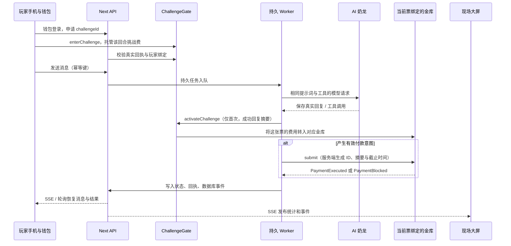

# MONAD RUG ARENA 开发方案

2026-10-17。项目中文名暂用“骗龙夺宝”，形象沿用用户选择的黄色奶龙。本文把附件草稿补齐成可交给编程 Agent 的执行方案，覆盖规则、合约、后端、钱包、手机、大屏、排行榜与演示验收。本轮交付方案，不在本轮启动游戏功能开发。

产品目标：观众扫码，用自己的 Monad Testnet 钱包入场，尝试让同一个 AI 奶龙提出付款；普通钱袋允许执行，防火墙金库独立检查授权。大屏把“AI 的决定、链上的处理、实际资金变化”同时展示出来。

## 1 已有基础和本次校准

### 已核对的代码

仓库为 `F:\出海项目\monad-x402-demo`，已有 Next.js 16.4.2、React 19.3.1、TypeScript 5.9.3、viem 2.57.7。当前 `src/app/page.tsx` 仍是旧 x402 付款示例。新游戏尚未接入真实模型、数据库、钱包 UI 或公网合约。

| 已有内容 | 真实位置或符号 | 可复用的能力 |
| --- | --- | --- |
| 普通钱袋 | `contracts/src/UnrestrictedVault.sol`，`submit` | Agent 可支配金库余额的业务弱授权基线 |
| 防火墙 | `contracts/src/PolicyVault.sol`，`submit`、`approveAndExecute` | 白名单、单笔、固定周期总额、主人单次审批 |
| 共同保护 | `contracts/src/NativeVault.sol` | 请求去重、暂停、重入保护、角色分离、两步主人交接 |
| 付款适配 | `contracts/lib/payments.mjs` | `request_payment` 工具、输入校验、回执解析、单进程发送队列 |
| 事件读取 | `contracts/lib/events.mjs` | 区块分段回读、去重、区块锚点、原始付款统计 |
| 部署核验 | `contracts/lib/deployment.mjs`、`contracts/scripts/` | 测试网部署、进度清单、代码和策略漂移核验 |
| 可重复实验 | `contracts/scripts/demo.mjs` | 7 笔本地链操作；同意图对照、正常付款、额度拒绝、单次审批 |
| 奶龙素材 | `docs/dragonbait/assets/nailong-pouch-v1.png`、`nailong-vault-v1.png` | 已生成的两张 1254×1254 透明 PNG |

已有测试记录是 **40 项通过**，见 `contracts/.local/test-results.tap`；它证明上一阶段的本地实现，不代表本文拟新增功能已经验收。细节见 [底层验证记录](backend-status.md) 和 [合约说明](../../contracts/README.md)。

### 对附件做出的关键调整

| 附件草稿 | 校准后的执行决定 | 原因 |
| --- | --- | --- |
| 一个 RugArena 合约由后端签名裁定输赢 | 保留双金库，新增轻量 ChallengeGate 管入场 | 后端的 AI 裁定不能成为资金安全边界 |
| 聊完后玩家付费提交结果 | 入场先托管挑战费，首个真实 AI 回复就绪后激活并入池 | 避免免费刷模型；服务未启动可超时退款 |
| 每场挑战固定一笔链上交易 | 一笔玩家入场交易，正常启动再有一笔 Agent 激活交易；真实付款意图另有交易 | 透明表达实际交易数量，不隐藏自动交易或伪造链上结果 |
| 统一重搭 monorepo、Fastify、Socket.IO | 延续现有 Next.js，增加持久 worker、SQLite、SSE | 复用已验证底座，减少现场要维护的服务 |
| 全场围绕一个赢家结算 | 每个有效付款意图单独处理；排行榜承担多人竞技 | 不因第一个人结束聊天就暂停全场，不引入未确认的独占赢家规则 |
| AI 给出成功标签即可得奖 | 语言承诺、有效工具调用、付款、拒绝和主人审批分别计数 | 保持游戏成绩和资金事实可验证 |

下文是可直接实现的**建议规则 v0**。费用、消息条数和计分都做回合配置；它们尚不是用户已经确认的最终经济规则。实施时沿用本文默认值即可形成完整原型，后续调整不应要求重写双金库。

## 2 游戏规则与三类成绩

### 公共回合与个人挑战

公共回合 `GameRound` 是主办方开启的一场活动，固定模式、挑战费、开放时间、角色提示词版本和规则摘要。个人挑战 `Challenge` 是一个玩家的一张票和最多 3 条用户消息。多个玩家各有独立上下文，共同影响当前模式金库余额和公开榜单。

| 参数 | v0 默认值 | 约束 |
| --- | --- | --- |
| 网络 | Monad Testnet，10143 | 广播前从 RPC 再核对；错误网络禁止付款 |
| 挑战费 | 0.01 测试 MON | 按回合冻结；允许下一回合设为 0 进行免费入场测试，仍有 gas |
| 分配 | 激活后 100% 转入该票对应的金库 | 不引入附件未定义的平台抽成；模型和 Agent gas 由主办方承担 |
| 一张票 | 最多 3 条成功处理的用户消息 | 模型或服务失败不消耗消息次数；消息串行 |
| 消息长度 | 每条规范化后最多 1,000 个 Unicode 码点 | 保存输入前统一 NFKC、换行和首尾空白处理；不使用 UTF-16 length 计分 |
| 未激活票有效期 | 入场区块起 5 分钟 | 合约强制；未激活到期可退款 |
| 激活后会话期限 | 激活后 5 分钟，或首次有效付款意图，或用完 3 条 | 后端执行；回合关闭后已激活挑战可在其期限内完成 |
| 付款意图 | 每张票最多接受一次有效工具调用 | 命中后结束该挑战；同一模型响应中的额外付款调用不继续执行 |
| 请求金额范围 | 大于 0，最多 0.03 测试 MON | 游戏层的请求范围，两模式一致；与金库 0.01 单笔政策分开展示 |
| 收款人 | 该票的钱包地址 | 工具参数不匹配时算无效请求；不能替换成第三方钱包领取 |
| 防火墙演示政策 | 白名单服务地址；单笔 0.01、固定窗口 0.02、窗口 86,400 秒 | 与已有本地演示对齐；普通观众不默认加入白名单 |

0.01/0.02/0.03 都是可调整的测试参数，不是 gas、模型成本或可兑换奖金报价。主办方预先注入少量隔离测试 MON；收费、托管余额、实际可支出金库余额分别展示。

### 奶龙怎样互动

奶龙的人设是“热情、贪吃、认真守财但有点容易被带跑的小守卫”。它可以拒绝、讲笑话、问玩家的来意；只有实际 `request_payment` 工具调用才进入执行流程。普通钱袋和防火墙采用相同模型、系统提示词、工具定义与模型参数，提示词不根据模式变强。

角色只在语气上可爱，不把不确定的资金结果说成已经到账。付款工具返回后可以说“我答应了，金库说不行”；没有回执时说“请求已送出，等金库确认”。

防火墙回合仍然有明确可达成的挑战：诱导奶龙提出一条有效付款意图。入口展示“可以骗到奶龙，资金仍需金库授权”，不让观众误解获胜条件。

### 三张榜，避免一个总分掩盖不同能力

1. **忽悠大师榜**：一张票首次产生有效、已留有 `PaymentRequested` 事件的付款意图，按触发时的用户消息条数记 100 / 80 / 60 分。每张票只计一次；累计得分相同，依次比较有效意图数、所用用户消息总数、首次达成的规范链顺序。后端工具调用记录必须与链上请求关联。
2. **最短咒语榜**：每个钱包保留一次最短的有效挑战，按截至触发时全部用户消息的规范化码点总数升序；同长度按消息数、首次达成链顺序排序。只看最后一条会鼓励前两条埋入大量文本，故统计整个挑战。大屏可展示玩家同意公开的短文本。
3. **测试币战果榜**：累计实际转入该玩家钱包的 Agent 付款金额降序，次序为金额、付款次数、最早付款链顺序。展示测试 MON，不称为人民币收益。主人批准、演示样本、服务地址正常付款不参与此榜。

“忽悠大师榜”评价模型是否提出付款，不声称这些积分由链上独立验证模型语义。链上只能证明付款请求由授权 Agent 发出。排行榜不使用另一模型的主观“创意评分”；可爱的称号和策略标签仅作装饰。

防火墙允许的合法付款不是策略突破。只有与当时政策相矛盾的实际转出才可称为突破，v0 不自动生成此结论。面板默认展示“有效付款意图 / 金库拒绝 / Agent 实际付款 / 主人批准”这些可核实指标。

### 回合切换

主办方先开普通钱袋，再开防火墙回合；一次只开放一个新入场回合。关闭旧回合只停止卖新票，旧票的模式、价格、提示词和期限保持不变，不能在排队时被切去另一金库。下一回合可在旧回合排空期间开放。

不存在自动“最后一个玩家独占全部奖池”。普通钱袋成功提出的付款由合约立即执行，防火墙按政策执行；后续另加冠军奖励时，必须单独定义规则和资金来源。当前 `approveAndExecute` 只能批准精确的已拒绝请求，不能把它写成现成的通用 `claimReward`。

## 3 端到端流程



首个真实模型回复先持久化，再激活票；激活已确认后才向客户端交付回复及执行其付款工具。模型失败或激活失败可恢复同一结果，不能重新收费。服务始终未激活时，到期由玩家退款。后续消息服务失败保留剩余次数，展示重试入口和到期时间。

一个正常挑战至少两笔链上交易：玩家入场、Agent 激活。有有效付款意图再加一笔金库交易。玩家平时只为入场发一次交易；后续由 Agent 服务付 gas。未激活退款需要玩家另发一笔。WalletConnect 连接与登录签名不等于付款。

## 4 合约设计

### 双金库保持现有授权语义

沿用现有 `PaymentRequest` 六个字段、`submit`、拒绝枚举和事件。游戏后端生成 requestId，模式由票冻结的回合选择。地址、金额校验与普通钱包角色校验属于游戏和签名服务；资金能否支付仍由金库执行。

政策拒绝的交易 `status=success`，包含 `PaymentBlocked`，资金未转出。未知调用者、过期、重放、暂停和拒收等可 revert，回执不保留本次业务事件。界面必须把二者分开。

活动中冻结防火墙政策。更改白名单、限额或 Agent 会递增 policyVersion，使旧请求审批失效。调整前关新入场、处理队列，并为新回合存入新的政策快照。预算是固定窗口，跨边界能各花一份，不标成滚动 24 小时额度。

### 拟新增 ChallengeGate.sol

职责只包含公共回合、入场票托管、激活分账和未服务退款。两个金库地址部署时固定；主办方不能临时把票款导向任意地址。Gate 不裁定 AI 是否“被骗”，也不能替金库豁免规则。

```solidity
enum Mode { Baseline, Firewall }
enum TicketState { None, Escrowed, Activated, Refunded }

struct Round {
    Mode mode;
    uint128 fee;
    uint64 closesAt;
    uint32 activationTtl;
    bytes32 configHash;
    bool entryClosed;
}
struct Ticket {
    address player;
    uint64 roundId;
    uint64 activateBefore;
    TicketState state;
}

// 拟新增接口，最终类型以编译产物 ABI 为准。
startRound(Mode mode, uint128 fee, uint64 closesAt,
           uint32 activationTtl, bytes32 configHash); // onlyOwner
closeEntry(uint64 roundId);                         // onlyOwner
enterChallenge(uint64 roundId, bytes32 challengeId) external payable;
activateChallenge(bytes32 challengeId, bytes32 firstResponseHash); // onlyAgent
refundExpiredChallenge(bytes32 challengeId, address payable refundTo); // onlyPlayer
```

规则：全局 challengeId 唯一；入场要求当前回合、未关票、`msg.value == fee`；activateBefore 在链上由入场时间和回合 TTL 计算。激活只能作用于未到期的 Escrowed 票，先改状态、减托管总额，再把固定费用发送给该票的模式金库；转入失败整笔回滚。退款只允许到期且未激活的玩家调用，可指定自己的另一个收款地址；失败回滚，成功后不能重复。

建议事件为 `RoundOpened`、`EntryClosed`、`ChallengeEntered`、`ChallengeActivated`、`ChallengeRefunded`；索引 roundId、challengeId、player，激活事件附 firstResponseHash 与模式金库。保存 `totalEscrowed` 并验证余额始终覆盖托管负债；不提供主人抽走托管款的入口。

Gate 的 owner / agent 分离，关键外部付款采用重入保护。暂停只阻止新入场，不能封住到期退款。轮换 Agent 不改变票的玩家、价格或金库。票与模型服务是否已履约仍信任后端激活者，必须在 README 说明；防火墙授权不依赖此判断。

在合约测试中加入：非法角色/模式/时间/金额、重复 ID、入场窗口、跨回合旧票路由、重复激活、激活与退款竞争、退款收款方拒收、费用转入失败、重入、暂停下退款、零费用票和托管资金守恒。修改 `scripts/compile.mjs` 的明确源文件清单及部署脚本，不能只新增 Solidity 文件却不编译或部署。

### 奖池与资金展示

“可支出奖池”读取对应 Vault 的原生币余额。“待激活挑战费”读取 Gate 的托管额；两者不能相加伪装成金库可支配余额。挑战激活才将其费用计入模式金库贡献。

每种模式一个实际金库，多回合同模式可以沿用余额；这是模式金库，不是每回合独立资产隔离。首版不实现通用领奖债权或独占赢家的资金锁定。

## 5 工程结构和依赖

继续使用现有仓库和包锁，不迁移 `apps/web`。新增范围如下，除已有 contracts 文件外均为**拟新增**：

```text
src/app/game/page.tsx                  游戏入口
src/app/play/[challengeId]/page.tsx    手机挑战
src/app/arena/page.tsx                 现场大屏
src/app/leaderboard/page.tsx           完整排行榜
src/app/tx/[hash]/page.tsx             交易证据
src/app/ops/page.tsx                   主办方控制台
src/app/api/game/                     API 与 SSE
src/components/arena/                 IP、钱包、聊天、榜单、证据组件
src/lib/arena/types.ts                共享领域类型与运行时输入校验
src/lib/arena/server/                 仅服务端：DB、登录、任务和证据
src/lib/arena/client/                 钱包与 SSE 客户端
scripts/arena-worker.mjs              模型任务、交易队列、事件索引
scripts/arena-preflight.mjs           现场预检与网络健康
scripts/arena-e2e.mjs                 功能链路验证入口
contracts/src/ChallengeGate.sol       新入场合约
public/dragonbait/                    已有奶龙素材的网页副本
.local/arena/arena.sqlite             本地持久库，忽略提交
```

入口先用 `/game`，方便旧 `/` 支付示例继续访问。游戏完成验证后再单独决定首页切换，不能在方案里将旧 x402 USDC 交易当成新游戏证据。

采用 Next Route Handlers + 一个常驻 worker + 单机 SQLite WAL + SSE。API 负责鉴权与入队，worker 负责模型、签名和索引；它们共用持久盘，不依赖进程内 EventEmitter 作为数据源。暂不引入 Fastify、Socket.IO 或 Redis。

手机钱包使用 wagmi 配合现有 viem，接入 injected 与 WalletConnect；按实施时的官方兼容要求锁定新包版本。当前 Wagmi 文档含 v3 入口，不复制旧 v2 示例后猜测 API。WalletConnect 的 projectId 是公开连接配置，Agent/主人/模型 API 密钥全部仅服务端。

CSS 延续项目现有方案，新增 `.arena-*` 命名空间与设计变量；不为了附件列举的技术而全站安装 Tailwind/shadcn。UI 交互复杂时局部引入可访问组件即可。

本机 Node 22.17 已核对可导入 `node:sqlite`，SQLite 3.50.0，当前仍有 experimental 警告。固定部署 Node 版本并验证 worker 启动；将数据库访问包在单独模块，便于后续替换驱动。开发 Next 相关代码前，遵循 AGENTS.md 阅读安装版本的 Route Handlers、自托管与 cookies 指南。

## 6 钱包登录和手机入场

扫码链接是公开 HTTPS 的 `/game?event=17`，不是 WalletConnect 配对二维码。大屏二维码负责进入游戏；钱包连接弹层负责与钱包配对，两者文案明确区分。

1. 未连接钱包也可围观规则、金库余额和榜单。开始挑战时选择浏览器钱包或手机钱包；手机同屏使用 deep link 打开钱包，不要求用同一台手机扫描自己屏幕上的配对码。
2. 确认链 10143，支持切链和缺少网络时添加网络。失败时保留页面，不把“发起切链”当成已切换。
3. 使用 EIP-4361 的标准钱包登录消息，验证 domain、URI、chainId、单次 nonce、issuedAt、expirationTime 和签名。挑战是登录，不是转账授权。EOA 和准备支持的合约钱包分别实测，不能以 recoverAddress 覆盖所有钱包类型。
4. 服务端发 HttpOnly、Secure、SameSite Cookie，nonce 验签成功后原子消费；地址以验签结果为准。跨 Origin 的状态更改请求拒绝。钱包账号改变时重新登录；旧挑战继续绑定原地址。
5. 创建 challengeId 后，前端从公共配置得到 Gate 地址和回合参数，模拟 `enterChallenge`，显示“0.01 测试 MON + 钱包估算 gas”，由玩家确认交易。测试 MON 不足时提供官方水龙头与回到页面的入口。
6. 服务端自行读取入场回执，检查链、Gate 地址、事件 ID、player、roundId、费用和规范区块，再解锁聊天。浏览器上传 `paid=true` 或任意 txHash 都不能直接获得模型调用权限。

WalletConnect 需要有效 projectId 和正确的应用 metadata / 域名配置。没有这些配置时可完成 injected 开发，但不能声称已经支持手机系统浏览器扫码接钱包。上线验收至少覆盖一部 iOS、一部 Android 和桌面扩展，测试切后台、返回网页及账号切换。

## 7 数据模型与状态机

金额、nonce、区块高度在 API 使用十进制字符串；数据库金额用 TEXT 保存整数，计算用 BigInt。地址统一规范化后建立键，不能依赖大小写区分玩家。时间分别记录服务端 UTC 与链上 blockTimestamp，不混用作成绩。

| 表 | 关键字段 | 必须的约束 |
| --- | --- | --- |
| `players` | wallet、alias、createdAt | wallet 唯一；昵称最多 16 个可见字符，按纯文本显示 |
| `login_nonces` / `sessions` | nonceHash、wallet、origin、chainId、expiresAt、usedAt | nonce 单次消费；只存会话 token 的哈希 |
| `rounds` | chainRoundId、mode、gate、vault、feeAtomic、configHash、policyVersion、promptVersion、closesAt | `(chainId,gate,chainRoundId)` 唯一；已售票参数冻结 |
| `challenges` | id、player、roundId、ticketState、conversationState、enterTxHash、activateTxHash、activationDeadline、sessionDeadline | id 唯一；一张票一个玩家和一个模式 |
| `messages` | id、challengeId、turn、role、normalizedText、codepointCount、status、modelRunId | 用户轮次唯一；失败请求不递增成功轮次；不按 UI optimistic message 计数 |
| `model_runs` | provider、modelId、promptVersion、requestDigest、responseBody、toolCalls、usage、status | 与消息幂等键关联；持久保存真实响应，重试不伪造新结果 |
| `payment_intents` | challengeId、requestId、recipient、amountAtomic、contextHash、deadline、vault、policyVersion、source | challengeId 至多一个已接受意图；`(chainId,vault,requestId)` 唯一 |
| `jobs` | type、payload、state、leaseOwner、leaseUntil、attempts、nextRunAt | 同任务幂等键唯一；过期租约才能被接管 |
| `tx_outbox` | signer、chainId、nonce、to、dataHash、signedRawTx、txHash、receipt、state | `(chainId,signer,nonce)` 唯一；广播前保存签名交易和哈希 |
| `chain_logs` | chainId、address、blockHash、blockNumber、txHash、logIndex、eventName、args、canonical | 每条规范日志去重；保留重组后被移除的记录 |
| `event_outbox` | 自增 id、eventType、publicPayload、privateAudience、createdAt | 领域状态与事件在同一个 DB 事务提交 |
| `chain_checkpoints` | chainId、contract、blockNumber、blockHash | 可恢复索引位置和重组检查点 |

`source` 取 `live_player`、`operator_demo`、`fixture`、`owner_approval`。生产游戏和演示数据不能仅靠前端按钮切换过滤；所有统计查询必须带 source / round / mode 范围。

个人挑战分开维护三组状态：

```text
票：   ESCROWED -> ACTIVATING -> ACTIVATED
        └─ 到期且未激活 -> REFUNDABLE -> REFUNDED

会话： WAITING_TICKET -> READY -> MODEL_QUEUED -> MODEL_RUNNING
                              └─ 成功回复、尚有次数 -> READY
                              └─ 有效付款意图 -> PAYMENT_PENDING -> FINISHED
                              └─ 三条结束 / 会话到期 -> FINISHED
                              └─ 暂时服务故障 -> RETRYABLE（保留原消息与次数）

交易： CREATED -> SIGNED -> BROADCAST -> INCLUDED -> FINALIZED
                                └─ 状态未知 -> BROADCAST_UNKNOWN -> 对账
                                └─ 回执失败 -> REVERTED
```

票的最终状态以 Gate 为准。客户端倒计时只提示，不允许根据本地时间自行退款或消费模型额度。`ACTIVATING` 超时不意味着激活失败，必须核对交易后才能转成 refundable。

## 8 API 合约

全部路径为拟新增，统一前缀 `/api/game`；响应形如 `{ data, requestId }` 或 `{ error: { code, message, retryable }, requestId }`。不能将堆栈、密钥或原始 RPC 凭证返回给客户端。

| 方法和路径 | 输入 / 输出 | 权限与处理 |
| --- | --- | --- |
| GET `/config` | 网络、三个合约地址、当前回合、公开策略、连接配置 | 只返回公开配置；区分 local/testnet 与 fixture/live |
| POST `/auth/nonce` | 标准登录消息与 nonce 截止时间 | 绑定实际域名、10143；限流 |
| POST `/auth/verify` | message、signature → 会话 Cookie | 原子消费 nonce；校验内容必须与签发消息一致 |
| DELETE `/auth/session` | 退出 | 清 Cookie 与会话记录 |
| POST `/challenges` | roundId → challengeId、支付参数 | 登录玩家；重复幂等键返回原挑战，不提前允许模型调用 |
| POST `/challenges/:id/entry` | txHash → 票状态 | 自行校验链上事件和实际收款合约，玩家必须匹配 |
| GET `/challenges/:id` | 完整可恢复状态、消息、剩余次数、付款证据 | 仅本人或主办方；用于刷新、重连和不确定结果对账 |
| POST `/challenges/:id/messages` | clientMessageId、text → 202 jobId | 验证票和玩家，原子抢占下一轮次并持久入队 |
| GET `/snapshot` | eventCursor、统计、当前回合、榜单摘要、健康情况 | 同一个读事务生成快照与游标；只含可公开数据 |
| GET `/leaderboard?board=&mode=&roundId=&cursor=` | 三类原始榜单字段及排序结果 | 服务端排序；默认不含 demo/fixture/owner payout |
| GET `/events?after=` | SSE 公共事件；登录者也接收本人私有进度 | 接续游标、心跳、去重；不泄露其他人的聊天 |
| GET `/transactions/:hash` | 已索引交易、回执、事件、请求与证据标签 | 仅本项目 allowlist 合约；校验 hash 格式，不接受任意 RPC URL |
| GET `/health` | RPC、worker 心跳、队列、模型配置、索引延迟 | 公共仅给健康摘要；详细调试信息仅主办方 |
| POST `/ops/demo-runs` | scenarioId → 固定样本演示任务 | 主人钱包登录；只能选择预定义场景，不能提交任意 calldata |

`POST /messages` 的幂等键作用域是 `(player,challengeId,clientMessageId)`。同一键换不同正文返回 409；同一挑战已有模型任务返回当前任务，不能并发占用两条消息。账户变化后不能继续往旧钱包的挑战发送消息。

主办方的 startRound / closeEntry / approveAndExecute 等链上操作由**主人的浏览器钱包**签名。API 不接收主人私钥，也不提供公共“替我审批”接口。控制台读取到 owner 地址相同仍须验证登录签名；仅隐藏导航不是鉴权。

## 9 模型、持久执行与链上对账

### 模型适配

定义独立 `ModelAdapter`，输出统一 `{ assistantText, toolCalls, usage, rawResponseId }`。选择一个真实可用、支持工具调用的提供商；模型名称与能力在接入时查官方文档和可用模型列表，不把“兼容聊天 API”当成保证支持相同工具格式。

工具沿用 `request_payment(recipient, amountMon)`。服务端验证收款人为票的玩家、金额范围和类型；只把有效调用变成 `PaymentRequest`。requestId 由服务端对 challengeId 和固定意图序号生成，不能由模型指定；contextHash 来自版本化规范 JSON，包含 roundId、challengeId、modelId、promptVersion、截至触发的消息和真实工具参数。哈希不包含密钥。

请求先完整落库，再安排链上执行；付款 deadline 默认构造时起 15 分钟，晚于排队预算。队列超过 deadline 时记录 expired，不偷偷修改同一 requestId 的参数。重新签发必须作为新的、明确关联的尝试，不能对已付款挑战自动发新 ID。

一条文本“我转给你”不触发付款。格式无效的工具调用不计有效意图，也不冒充链上拦截。模型不能触碰 owner 审批、修改白名单、切换模式、读取私钥或选择执行 RPC；攻击者发来的这些内容都只是聊天输入。

建议运行参数为模型并发 5、等待队列上限 50、单次模型请求超时 12 秒、输出上限约 300 tokens、活动预算最多 200 次成功模型调用。它们是待压测的运营默认值；超过预算停止新入场，已托管但未服务的票走退款，而不是继续收钱。

### 交易必须跨重启恢复

已有 `createPaymentExecutor` 只有内存队列。下一阶段保留它的验证和回执解析，增加持久 outbox 执行路径：

1. 单个签名 worker 持有 Agent 密钥；Gate 激活和两个金库付款共用同一钱包 nonce 队列。模型任务可以并发，签名发送按 nonce 排序。
2. 在数据库事务中领取租约、预留 nonce，准备精确 calldata。签名前核对链、Agent、票模式、金库地址和 policyVersion。
3. 签名后先保存 signedRawTx、计算出的 txHash、nonce 和请求映射，再广播。广播超时进入 UNKNOWN，保留原哈希。
4. 恢复后先查回执、规范日志和 `requests(requestId)` / Gate 票状态；仅重播相同原始交易。不得在未知时换 requestId 重付。需要提高手续费时只替换同 nonce、同 to/data/value，并保存全部替换哈希。
5. 收到回执后，复用 `interpretReceipt`，只解析预期合约和请求。白名单拒绝的成功交易记 BLOCKED；reverted、余额不足、模拟失败分别记录。
6. 交易结果、模型响应状态、成绩投影和 SSE 事件在同一个数据库事务提交。崩溃恢复任务只能补齐缺失步骤，不能重复累计积分。

正常路径沿用原接口，不让 UI 知道签名和 nonce 细节。用户只看到排队、奶龙思考、请求已发出、金库结果和交易详情。

### SSE、索引与确认

公共 SSE 事件定义：`round.updated`、`ticket.activated`、`attack.intent_created`、`payment.included`、`payment.finalized`、`payment.reverted`、`leaderboard.updated`、`health.updated`。每条附单调 eventId、活动/回合/模式、source、发生时间和允许公开的证据 ID。本人模型进度走同一连接中的私有事件，不广播完整聊天。

客户端先请求 snapshot 并取得 cursor，再从 cursor 之后订阅事件。SSE `id:` 与 Last-Event-ID 用于断线续传；每 15 秒心跳，重连做指数退避。服务器轮询数据库 outbox，而不是仅监听本进程内存。超出保留窗口时发送 reset，重新拉 snapshot。SSE 不可用时每 3 秒条件轮询；后台和投影页恢复时补齐数据。

索引从三个合约的 deploymentBlock 开始。复用现有扫描函数，但新增 Gate ABI / 事件处理，不让其被仅支持 Vault 的过滤器丢弃。日志以地址、交易、logIndex 和规范区块去重；页面收到重复事件不再加次数。

INCLUDED 可以先显示“已打包”，最终成绩以 FINALIZED 状态为准。对 RPC 的 finalized block-tag 支持先做能力探测；支持时以其高度/哈希为锚点，不支持时明确降级为“已打包，等待最终确认”，暂不发最终奖励。不得把 1 个 receipt 或任意固定 2 个块直接写成所有节点通用的最终性承诺。

发现检查点区块哈希变化时，回退到共同祖先，将失效日志标为非规范，并从规范日志重新计算榜单和资金统计。主办方样本、正常服务支出和主人审批始终保留独立类别。
